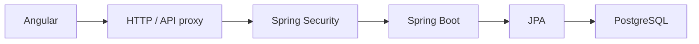

# Support Operations — Angular dashboard

An independently developed full-stack enterprise application engineering demonstration using **Angular, Java/Spring Boot, PostgreSQL, security, testing, CI and containerized development**. Separate from commercial/employer experience.

## Capabilities and data boundaries

- Fictional support tickets: in-memory search/filter/sort/pagination, detail, status and notes; reset on reload.
- API-backed fictional work orders: list/filter/pagination/detail through typed Angular HttpClient services.
- Explicit local-browser development build: session login, CSRF-protected create/status update, reload restoration, inactivity expiry and logout. PostgreSQL persists work orders.
- Reactive forms, independent backend validation, associated field errors, loading/empty/success/error states and responsive native controls.
- 75 Angular unit tests at M4C baseline; M5 adds real Chromium E2E against isolated Spring Boot/PostgreSQL, with SQL confirmation. Release gate checks and GitHub Actions verification complement tests.



Stack: Angular 22 standalone lazy routes/signals, TypeScript 6, RxJS, reactive forms and SCSS; Vitest unit tests and Playwright browser acceptance. No redundant browser framework or major design system.

## Run and verify

Requires supported Node (24 in CI), pnpm 11.19.0; Java 21/Docker for integrated E2E.

```bash
pnpm install --frozen-lockfile
pnpm start
pnpm test --watch=false
pnpm build
node scripts/verify_release.mjs
```

Generic development mode keeps API writes blocked. Production builds omit local login/write controls and the session transport. Public work-order reads need an approved API route; the dev proxy is not deployed with static assets.

For the real local workflow, build the sibling backend with Maven `clean verify`, install Chromium with `pnpm exec playwright install chromium`, then run `pnpm e2e`. Set M5_BACKEND_REPO if the backend is not a sibling checkout. The harness supplies ephemeral credentials; no production/operator .env is needed. [Complete reproduction, actual results and screenshots](docs/M5_E2E_VERIFICATION.md).

## Engineering and presentation

- [Architecture and orchestration](https://github.com/gizraelian/spring-work-order-api/blob/main/docs/ARCHITECTURE.md)
- [Security design and limitations](https://github.com/gizraelian/spring-work-order-api/blob/main/docs/SECURITY_DESIGN_SUMMARY.md)
- [Case study, interview walkthrough and portfolio card proposal](docs/PORTFOLIO_CASE_STUDY.md)
- [M4C verification history](docs/M4C_VERIFICATION.md)

The existing public ticket/API demonstrations are distinct from the isolated authenticated local workflow. No public authenticated deployment is claimed. Public routing, data exposure and production Flyway adoption remain separately gated. CI verifies; M5 does not publish the portfolio or deploy to Netlify/DigitalOcean.

MIT License.
